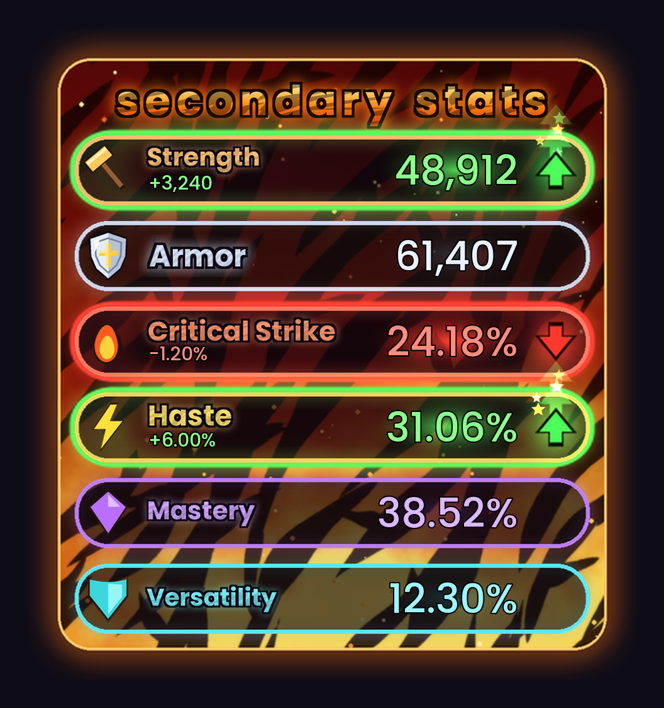
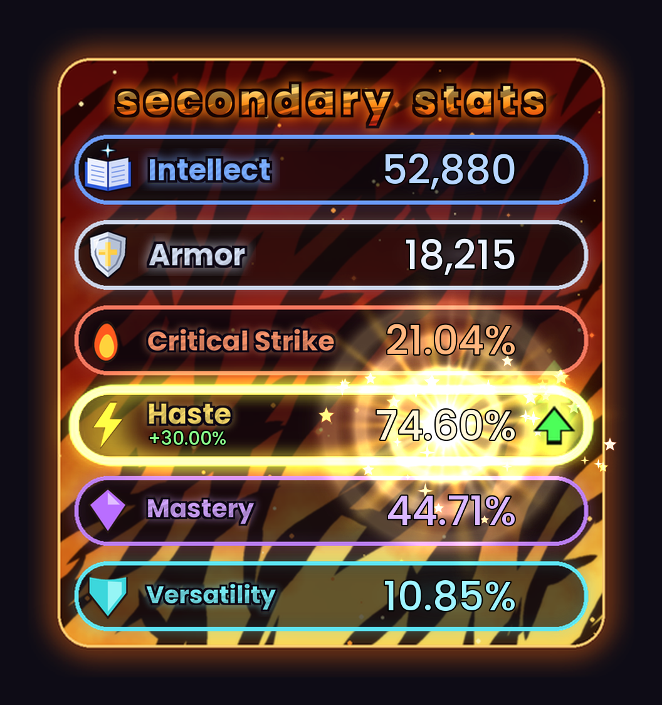
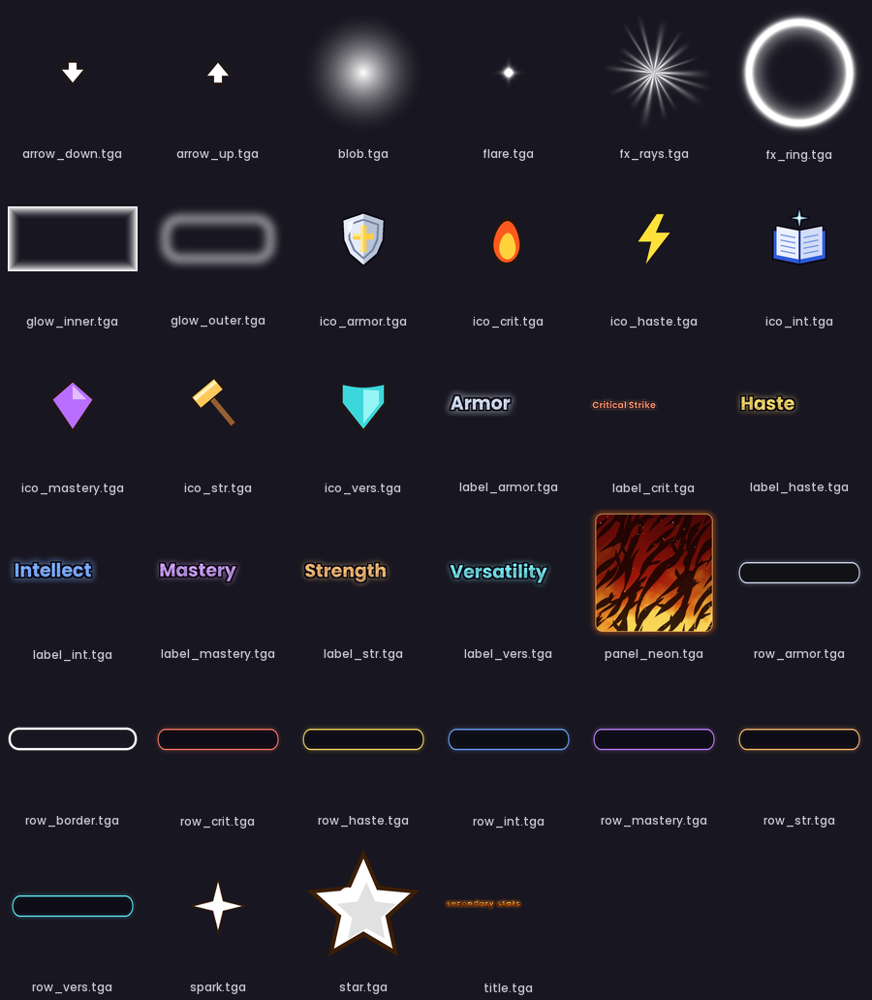

# ✨ StatSparkle

**Watch your stats move, live.** StatSparkle is a World of Warcraft addon that shows your primary stat, Armor and secondary stats in a glowing neon panel. When a trinket, proc or buff pushes a stat up or down, its row lights up **green** or **red**, an arrow bobs next to it, the exact change is shown, and a burst of cartoon stars pops out. If a stat climbs really high, it goes **supernova**.

*Protection spec: Strength and Haste are up from procs, Critical Strike is down, and the rest are at your normal values.*

---

## What it shows

| Stat | Colour | Shown as |
|---|---|---|
| 🔨 **Strength** / 📖 **Intellect** (primary) | Orange / Blue | Whole number, e.g. `48,912` |
| 🛡️ **Armor** | Silver | Whole number |
| 🔥 **Critical Strike** | Fiery red | Percentage |
| ⚡ **Haste** | Golden yellow | Percentage |
| 💜 **Mastery** | Purple | Percentage |
| 💠 **Versatility** | Teal | Percentage |

**Your primary stat follows your spec automatically:** Strength for Protection and Retribution, Intellect for Holy. Change spec and the row swaps on its own.

## 💥 Supernova

When a percentage stat reaches **60% or higher**, its number turns white-hot and the row explodes like a star: shockwave rings, spinning light rays, a flash, sparks and a little screen shake. It keeps getting wilder all the way up to 90%.

*Holy spec, with Haste gone supernova at 74.60%.*

## Features

- **Live updates.** Numbers change the moment a buff, proc, trinket or debuff affects you.
- **Green and red highlights.** A row glows green with an ▲ arrow when the stat is above your normal value, and red with a ▼ arrow when it's below. The change (`+6.00%`, `-1,240`) is shown under the stat name.
- **Sparkle effects.** Star bursts, a light sweep across the row, and glowing numbers that hop when a stat jumps. Stars and ghost arrows keep floating up while it stays raised.
- **Smart "normal" baseline.** StatSparkle learns your normal stats while you're out of combat and nothing is changing. It never updates during combat, so a long cooldown (like Avenging Wrath) can't be mistaken for "normal" and show a false drop afterwards. The baseline resets automatically when you change gear, spec or talents.
- **Correct crit for your role.** Uses spell crit for Intellect specs and melee crit for Strength specs.
- **Movable and resizable.** Drag it anywhere and scale it to fit your UI.
- **Optional sparkle sound** when stats change (off by default).

## Slash commands

| Command | What it does |
|---|---|
| `/ss` | Show help |
| `/ss test` | Fake one proc up and one proc down to see the effects |
| `/ss nova` | Fake a Haste supernova |
| `/ss nova 55` | Make supernova start at 55% (default 60) |
| `/ss nova off` | Turn the supernova effect off (`/ss nova on` to turn it back on) |
| `/ss unlock` | Unlock the panel so you can drag it |
| `/ss lock` | Lock it in place |
| `/ss scale 1.2` | Resize (0.3 to 3) |
| `/ss normal` | Treat your current stats as normal (resets the baseline) |
| `/ss sound` | Toggle the sparkle sound |
| `/ss reset` | Reset position, scale and settings |

`/statsparkle` works too.

## Installation

**CurseForge app:** search for **StatSparkle** and click Install.

**Manual:**
1. Download the latest release zip.
2. Extract it so the `StatSparkle` folder ends up at
   `World of Warcraft/_retail_/Interface/AddOns/StatSparkle/`
3. Restart the game or type `/reload`.

## Artwork

All textures are hand-made for this addon:

## Credits

- Made by **Ryan**
- Font: [Poppins](https://fonts.google.com/specimen/Poppins), used under the SIL Open Font License
