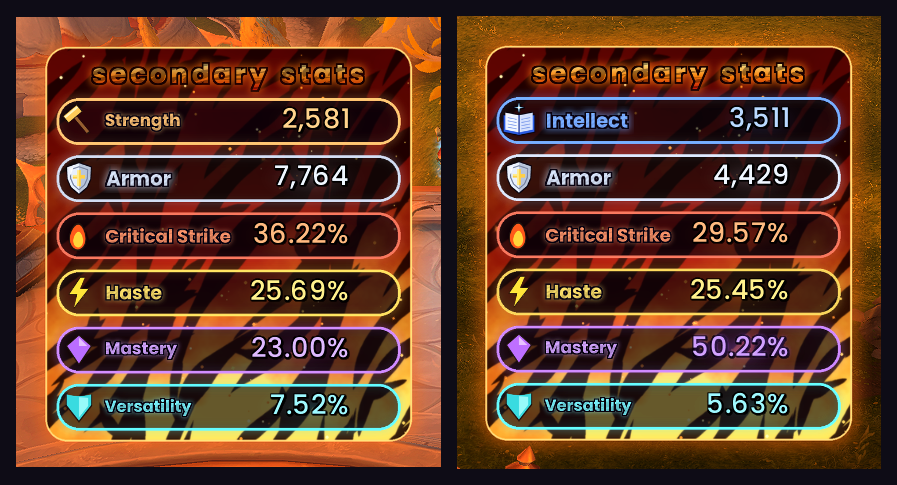
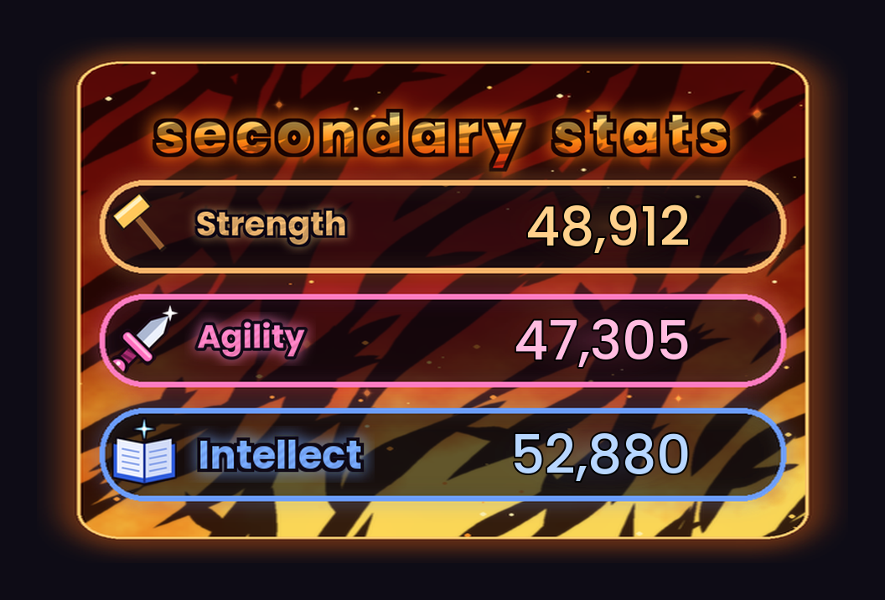
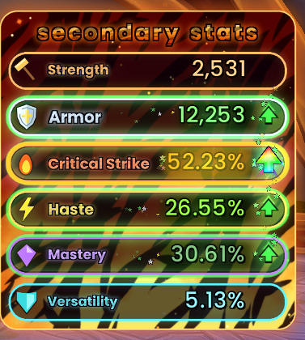
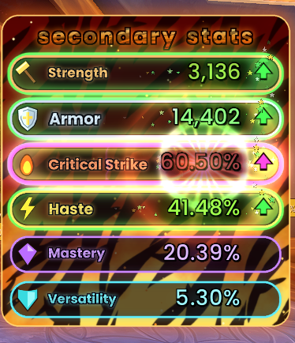

# ✨ StatSparkle

**Watch your stats move, live.** StatSparkle is a World of Warcraft addon that shows your primary stat, Armor and secondary stats in a glowing neon panel. It works for every class and spec, in and out of combat. When a trinket, proc or buff pushes a stat up or down, its row lights up **green** or **red**, an arrow bobs next to it and tiny cartoon stars pour out beside the number. When a stat climbs to **50%** and well above your normal, it goes into golden **jackpot mode** with crackling lightning and a rainbow phoenix arrow. At **60%** it goes **supernova**.

*Protection spec: Strength and Haste are up from procs, Critical Strike is down, and the rest are at your normal values.*

*In game: Strength on a Protection Paladin (left), Intellect after changing to Holy (right).*

---

## What it shows

| Stat | Colour | Shown as |
|---|---|---|
| 🔨 **Strength** / 🗡️ **Agility** / 📖 **Intellect** (primary) | Orange / Pink / Blue | Whole number, e.g. `48,912` |
| 🛡️ **Armor** | Silver | Whole number |
| 🔥 **Critical Strike** | Fiery red | Percentage |
| ⚡ **Haste** | Golden yellow | Percentage |
| 💜 **Mastery** | Purple | Percentage |
| 💠 **Versatility** | Teal | Percentage |

## One addon for every class

The top row always shows the primary stat that **your current spec** uses:

| Primary stat | Specs |
|---|---|
| 🔨 **Strength** | Warriors, Death Knights, Protection and Retribution Paladins |
| 🗡️ **Agility** | Rogues, Hunters, Havoc and Vengeance Demon Hunters, Feral and Guardian Druids, Brewmaster and Windwalker Monks, Enhancement Shamans |
| 📖 **Intellect** | Mages, Priests, Warlocks, Evokers, Holy Paladins, Balance and Restoration Druids, Elemental and Restoration Shamans, Mistweaver Monks, Devourer Demon Hunters |

When you change spec, only that row swaps to the new stat's colour, icon and lettering. The other rows stay as they are, and StatSparkle learns your normal stats again for the new spec.

## ⭐ Stars while a stat is up

While a stat is up, tiny cartoon stars in green, gold and white pour out to the left and right of the number. They stay inside the row and never cover the number.

## 🎰 Jackpot mode at 50%

When Critical Strike, Haste, Mastery or Versatility reaches **50% or more** and is at least **5% above your normal**, the row goes into jackpot mode. It's gold, so it stands apart from rows that are just green, and from red, which means a stat is down:

- a deep purple aura and a gold ring that shimmers between gold and orange
- purple and gold lightning crackling across the row, behind the number
- a number that shifts between gold and orange
- a rainbow phoenix arrow that flashes through every colour, glowing in a rainbow orb, with sparkles spraying off its tips
- stars in every colour pouring out either side

*Critical Strike at 52.23% in jackpot mode, with its gold number and rainbow phoenix arrow. Armor, Haste and Mastery are up from procs.*

The 5% rule means a stat that's always around 50%, like a Holy Paladin's Mastery, doesn't sit in jackpot mode all the time. It lights up when a proc or buff pushes it higher.

Out of combat you also hear a short shimmer as a stat goes into jackpot mode. It's the only sound StatSparkle makes, so it won't clash with your other addons. `/ss sound` turns it off.

The 50% point sits 10% below the supernova point, so `/ss nova 55` moves it to 45%.

## ⚔️ In combat

World of Warcraft: Midnight hides your exact stats from addons during combat. StatSparkle still shows the live numbers, and rows still light up green or red with the arrow, the stars, jackpot mode and the supernova. It lets the game do the comparison.

A few things only work out of combat: the exact change under the stat name (`+6.00%`), the star burst at the moment of a proc, the supernova's flash and screen shake, and the jackpot sound. Type `/ss combat` to preview the in-combat look.

*In combat on a Protection Paladin: Strength, Armor and Haste are up from procs, and Critical Strike has hit 60.50% and gone supernova.*

## 💥 Supernova

When a percentage stat reaches **60% or higher**, its number turns white-hot and the row explodes like a star: shockwave rings, spinning light rays, a flash, sparks and a little screen shake. It keeps getting wilder all the way up to 90%. In combat you still get the white-hot glow, the light rays and the shockwave rings.

*Holy spec, with Haste gone supernova at 74.60%.*

## Features

- **Live updates.** Numbers change the moment a buff, proc, trinket or debuff affects you.
- **Green and red highlights, in and out of combat.** A row glows green with an ▲ arrow when the stat is above your normal value, and red with a ▼ arrow when it's below. Out of combat, the change (`+6.00%`, `-1,240`) is shown under the stat name.
- **Sparkle effects.** Tiny cartoon stars pour out beside a number while it's up. Out of combat you also get star bursts, a light sweep and a hop when a stat jumps. Stars and ghost arrows keep floating up off the arrow while it stays raised.
- **Smart "normal" baseline.** StatSparkle learns your normal stats while you're out of combat and nothing is changing. It never updates during combat, so a long cooldown (like Avenging Wrath) can't be mistaken for "normal" and show a false drop afterwards. The baseline resets automatically when you change gear, spec or talents.
- **Correct crit for your spec.** Uses spell crit for Intellect specs, and melee or ranged crit for Strength and Agility specs.
- **Movable and resizable.** Drag it anywhere and scale it to fit your UI.
- **One gentle sound:** a shimmer when a stat goes into jackpot mode out of combat. Nothing else makes a sound.

## Slash commands

| Command | What it does |
|---|---|
| `/ss` | Show help |
| `/ss test` | Fake one proc up and one proc down to see the effects |
| `/ss combat` | Preview the in-combat look for 8 seconds |
| `/ss nova` | Fake a Haste supernova |
| `/ss nova 55` | Make supernova start at 55% (default 60). Jackpot mode starts 10% below that. |
| `/ss nova off` | Turn the supernova effect off (`/ss nova on` to turn it back on) |
| `/ss unlock` | Unlock the panel so you can drag it |
| `/ss lock` | Lock it in place |
| `/ss scale 1.2` | Resize (0.3 to 3) |
| `/ss normal` | Treat your current stats as normal (resets the baseline) |
| `/ss sound` | Turn the jackpot shimmer sound off or on |
| `/ss reset` | Reset position, scale and settings |

`/statsparkle` works too.

## Installation

**CurseForge app:** search for **StatSparkle** and click Install.

**Manual:**
1. Download the latest release zip.
2. Open the zip and drag the `StatSparkle` folder inside it into `World of Warcraft/_retail_/Interface/AddOns/`. You should end up with `AddOns/StatSparkle/StatSparkle.toc`.
   If you use Windows' **Extract All**, change the destination to the `AddOns` folder itself. Otherwise Windows adds an extra folder named after the zip, and WoW won't find the addon.
3. Restart the game. `/reload` isn't enough for new files.

## Artwork

All textures are hand-made. The lightning comes from Orion's Juggernaut Mode addon, and the little star and the rainbow phoenix arrow are drawn from Orion's own sketches.

## Credits

- Font: [Poppins](https://fonts.google.com/specimen/Poppins), used under the SIL Open Font License

## Author

Made by Orion ([rlucas2100](https://github.com/rlucas2100)).
