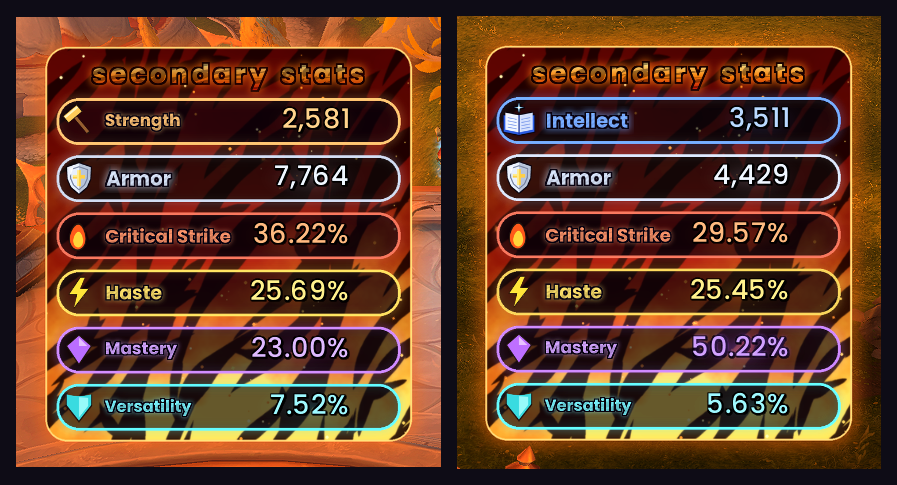
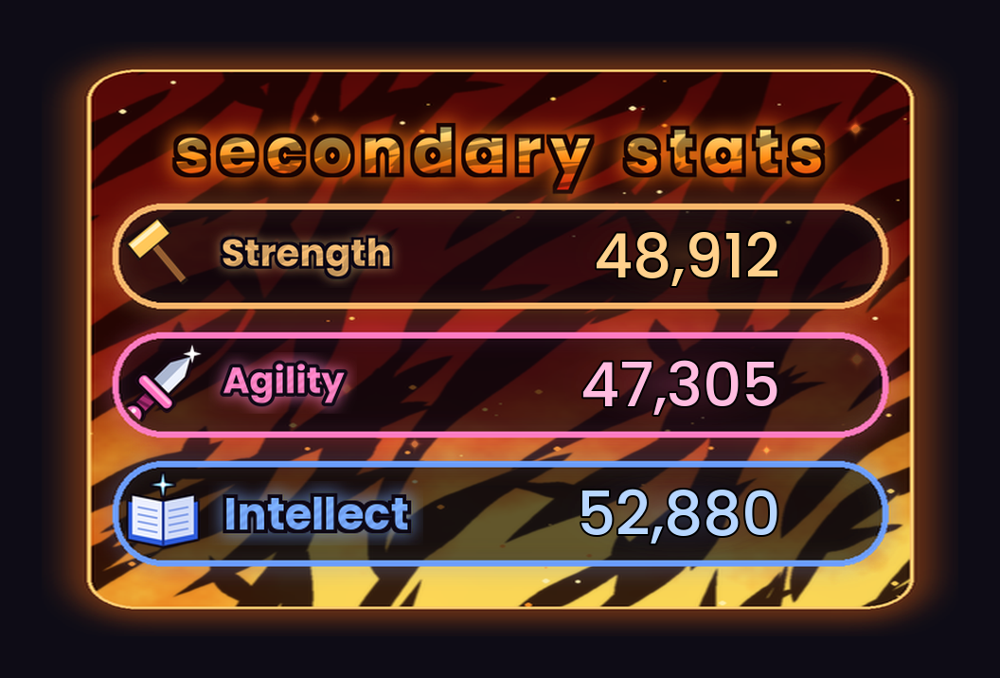
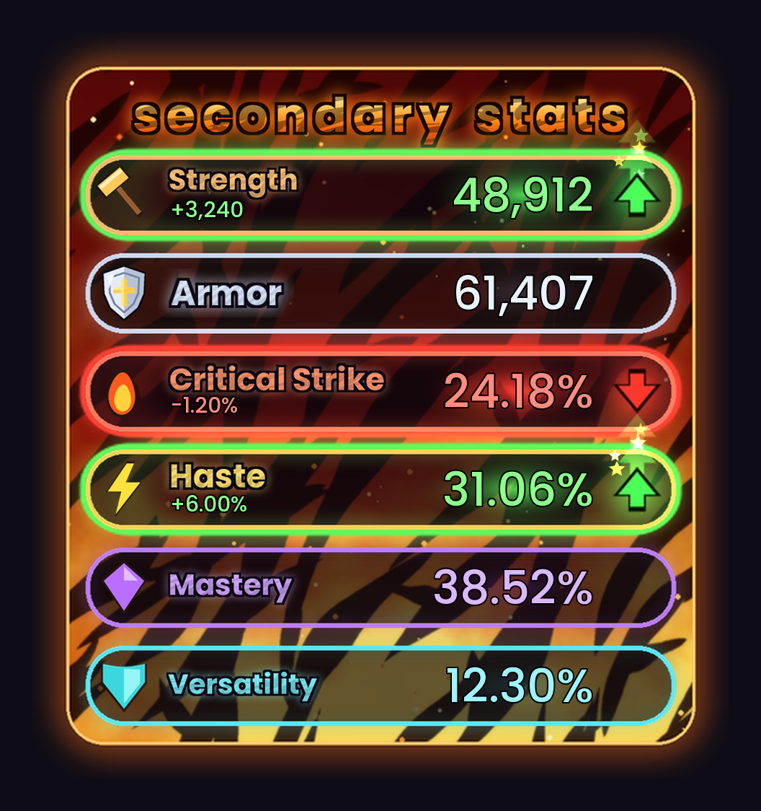
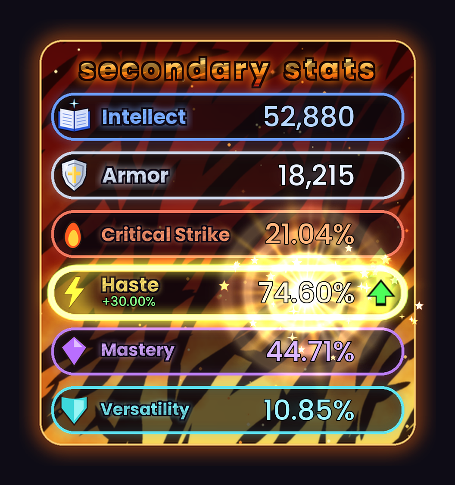

# ✨ StatSparkle

**Watch your stats move, live.** StatSparkle shows your primary stat, Armor and secondary stats in a glowing neon panel. When a trinket, proc or buff pushes a stat up or down, its row lights up **green** or **red**, an arrow bobs next to it, the exact change is shown, and a burst of cartoon stars pops out. If a stat climbs really high, it goes **supernova**.

**Works for every class and spec.** Strength, Agility or Intellect: StatSparkle shows the one your spec uses, and switches by itself when you change spec.

*In game: Strength on a Protection Paladin (left), Intellect after changing to Holy (right).*

---

## 🗡️ Strength, Agility or Intellect: picked for you

The top row always shows the primary stat that **your current spec** uses. You don't need a separate version for casters, healers, tanks or melee.

| Primary stat | Colour | Specs |
|---|---|---|
| 🔨 **Strength** | Orange | Warriors, Death Knights, Protection and Retribution Paladins |
| 🗡️ **Agility** | Pink | Rogues, Hunters, Havoc and Vengeance Demon Hunters, Feral and Guardian Druids, Brewmaster and Windwalker Monks, Enhancement Shamans |
| 📖 **Intellect** | Blue | Mages, Priests, Warlocks, Evokers, Holy Paladins, Balance and Restoration Druids, Elemental and Restoration Shamans, Mistweaver Monks, Devourer Demon Hunters |

**Changing spec:** only the primary stat row changes. It swaps to the new stat's colour, icon and lettering with a little burst of stars. The other rows stay as they are, and StatSparkle learns your normal stats again for the new spec. It also follows you when you swap talent loadouts or log in on another character.

**Crit is right for your spec too.** Intellect specs see spell crit. Strength and Agility specs see melee or ranged crit.

---

## What it shows

| Stat | Colour | Shown as |
|---|---|---|
| 🔨 Strength / 🗡️ Agility / 📖 Intellect | Orange / Pink / Blue | Whole number, e.g. `48,912` |
| 🛡️ **Armor** | Silver | Whole number |
| 🔥 **Critical Strike** | Fiery red | Percentage |
| ⚡ **Haste** | Golden yellow | Percentage |
| 💜 **Mastery** | Purple | Percentage |
| 💠 **Versatility** | Teal | Percentage |

*Strength and Haste are up from procs, Critical Strike is down, and the rest are at your normal values.*

## 💥 Supernova

When a percentage stat reaches **60% or higher**, its number turns white-hot and the row explodes like a star: shockwave rings, spinning light rays, a flash, sparks and a little screen shake. It keeps getting wilder all the way up to 90%.

*An Intellect spec with Haste gone supernova at 74.60%.*

## Features

- **Live updates.** Numbers change the moment a buff, proc, trinket or debuff affects you.
- **Green and red highlights.** A row glows green with an ▲ arrow when the stat is above your normal value, and red with a ▼ arrow when it's below. The change (`+6.00%`, `-1,240`) is shown under the stat name.
- **Sparkle effects.** Star bursts, a light sweep across the row, and glowing numbers that hop when a stat jumps.
- **Smart "normal" baseline.** StatSparkle learns your normal stats while you're out of combat and nothing is changing. It never updates during combat, so a long cooldown can't be mistaken for "normal" and show a false drop afterwards. It starts over when you change gear, spec or talents.
- **Movable and resizable.** Drag it anywhere and scale it to fit your UI.
- **Optional sparkle sound** when stats change (off by default).

## Slash commands

| Command | What it does |
|---|---|
| `/ss` | Show help |
| `/ss test` | Fake one proc up and one proc down to see the effects |
| `/ss nova` | Fake a Haste supernova |
| `/ss nova 55` | Make supernova start at 55% (default 60) |
| `/ss nova off` | Turn the supernova effect off (`/ss nova on` to turn it back on) |
| `/ss unlock` | Unlock the panel so you can drag it |
| `/ss lock` | Lock it in place |
| `/ss scale 1.2` | Resize (0.3 to 3) |
| `/ss normal` | Treat your current stats as normal |
| `/ss sound` | Toggle the sparkle sound |
| `/ss reset` | Reset position, scale and settings |

`/statsparkle` works too.

## FAQ

**Do I need a different version for my caster, healer or rogue?**
No. There is one StatSparkle for everyone. It reads your spec and shows Strength, Agility or Intellect to match.

**A row lit up right after I changed spec or gear. Why?**
Some passives take a moment to apply after a change. StatSparkle settles on your new normal stats once you're out of combat and nothing has changed for a few seconds. Type `/ss normal` to accept your current stats straight away.

**Can I see the panel without waiting for a proc?**
Type `/ss test` for an up and a down, or `/ss nova` for a supernova.

---

Source code and full changelog: [github.com/rlucas2100/Stat_sparkle_wow](https://github.com/rlucas2100/Stat_sparkle_wow)

Font: [Poppins](https://fonts.google.com/specimen/Poppins), used under the SIL Open Font License.

## Author

Made by Orion ([rlucas2100](https://github.com/rlucas2100)).
